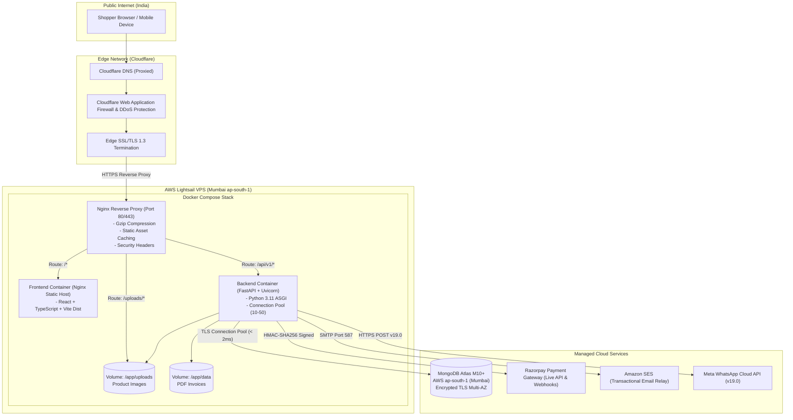

# SREE SAI KRISHNA COLLECTIONS (SSK)
## PRODUCTION HOSTING OPTIONS COMPARISON & ESTIMATED COST ANALYSIS (INR)

**Target Stack:**  
- **Frontend:** React + TypeScript + Vite (Static HTML/JS/CSS served via Nginx)  
- **Backend:** FastAPI (Python 3.11 with Uvicorn ASGI)  
- **Database:** MongoDB Atlas (AWS Mumbai `ap-south-1`)  
- **Reverse Proxy:** Nginx with Gzip & SSL  
- **Packaging:** Docker & Docker Compose  
- **Target Geography:** India (Consumers located across Telangana, Andhra Pradesh, Karnataka, Tamil Nadu, Maharashtra, etc.)  

---

## 1. DETAILED HOSTING PLATFORM COMPARISON MATRIX

| Evaluation Criteria | Option A: AWS Lightsail (Recommended for SSK) | Option B: DigitalOcean Droplet (Bangalore) | Option C: Render (PaaS) | Option D: AWS EC2 (t4g.small / t3.small) |
| :--- | :--- | :--- | :--- | :--- |
| **Instance Specs** | 2 vCPU, 2 GB RAM, 60 GB NVMe SSD | 1 vCPU, 2 GB RAM, 50 GB NVMe SSD | 1 Web Service (FastAPI) + 1 Static Site (Vite) | 2 vCPU (ARM Graviton2), 2 GB RAM, 30 GB EBS |
| **Data Center Location** | **Mumbai (`ap-south-1`)** | **Bangalore (`blr1`)** | Frankfurt / Singapore / US (No India region) | **Mumbai (`ap-south-1`)** |
| **Network Latency to India** | **Ultra-low (5–18 ms)** | **Ultra-low (8–22 ms)** | High (80–180 ms cross-border) | **Ultra-low (5–18 ms)** |
| **Monthly Compute Cost** | **$10 / month (≈ ₹840 / month)** | **$12 / month (≈ ₹1,008 / month)** | $14 / month (≈ ₹1,176 / month) | $15–$18 / month (≈ ₹1,260–₹1,510 / mo) |
| **Bandwidth Allowance** | **3 TB / month included** | 2 TB / month included | 100 GB included (Overage: $0.10/GB) | Pay-as-you-go ($0.09/GB egress) |
| **Database Connectivity** | Same AWS VPC / Region as Atlas Mumbai (< 2ms) | Public transit to Atlas Mumbai (~12ms) | High cross-border latency to Atlas Mumbai | Same AWS VPC peering (< 1ms) |
| **SSL / TLS Termination** | Automated via Certbot (Free Let's Encrypt) | Automated via Certbot (Free Let's Encrypt) | Automated Managed SSL | Automated via Certbot or AWS ALB |
| **Docker Compose Support** | **Full Native Support** | **Full Native Support** | Fragmented (Requires separate PaaS services) | **Full Native Support** |
| **Deployment Complexity** | **Low** (Single Ubuntu VPS running Compose) | **Low** (Single Ubuntu VPS running Compose) | Medium (Dual service configuration) | Medium/High (VPC, Security Groups, IAM) |
| **Backup & Snapshots** | Automated daily instance snapshot (≈ ₹150/mo) | Automated weekly backup (≈ ₹200/mo) | Not applicable to ephemeral containers | EBS Volume Snapshots (≈ ₹180/mo) |
| **TOTAL ESTIMATED MONTHLY COST** | **₹990 – ₹1,100 / month** | **₹1,200 – ₹1,350 / month** | **₹1,400 – ₹1,800 / month** | **₹1,500 – ₹2,000 / month** |

---

## 2. TOTAL ESTIMATED MONTHLY OPERATING EXPENSE (INDIAN RUPEES)

The table below breaks down the complete commercial infrastructure budget for Sree Sai Krishna Collections on Day 1:

| Line Item | Provider / Service | Tier / Plan | Monthly Cost (USD) | Monthly Cost (INR) |
| :--- | :--- | :--- | :--- | :--- |
| **1. Application Server (Frontend + Backend + Nginx)** | **AWS Lightsail** (Mumbai Region) | 2 vCPU, 2 GB RAM, 60 GB SSD, 3 TB Bandwidth | $10.00 | **₹840.00** |
| **2. Primary Database** | **MongoDB Atlas** (AWS Mumbai `ap-south-1`) | M10 Dedicated Replica Set (2 GB RAM, 10 GB NVMe) | ~$57.00 | **₹4,788.00** |
| **3. Transactional Email** | **Amazon SES** (Mumbai `ap-south-1`) | First 62,000 emails free/month (from EC2/Lightsail) | $0.00 – $1.00 | **₹0.00 – ₹84.00** |
| **4. WhatsApp Order Alerts** | **Meta WhatsApp Business Cloud API** | 1,000 free service conversations/mo; ₹0.78 per utility msg | ~$5.00 – $15.00 | **₹420.00 – ₹1,260.00** |
| **5. SSL / TLS Certificate** | **Let's Encrypt / Certbot** | Domain-Validated Wildcard TLS 1.3 | $0.00 | **₹0.00 (FREE)** |
| **6. Domain Registration & DNS** | **Cloudflare Registrar / Namecheap** | `.com` Top-Level Domain (annualized per month) | ~$1.00 | **₹84.00** |
| **7. Server Snapshot Backups** | **AWS Lightsail Automated Snapshots** | 60 GB disk snapshot retention | ~$1.50 | **₹126.00** |
| **ESTIMATED TOTAL MONTHLY BUDGET** | | | **~$74.50 – $85.50** | **₹6,258 – ₹7,182 / month** |

> **Cost Optimization Note (Initial Pilot Option):**  
> If the business owner wants to minimize costs during the first 30–60 days of private beta or soft launch before scaling to thousands of daily orders, the merchant can start with **MongoDB Atlas Shared (M2 / M5 tier at ~$9–$25/mo ≈ ₹750–₹2,100/mo)** or self-hosted MongoDB inside the Docker container with automated nightly S3 backups, bringing total monthly hosting costs down to **under ₹2,000 / month**. Once sales exceed 100 orders/month, the database can be scaled up to M10 with zero downtime.

---

## 3. RECOMMENDED PRODUCTION ARCHITECTURE

### Architecture Blueprint

### Why This Architecture is Ideal for Sree Sai Krishna Collections:
1. **Colocated in Mumbai (`ap-south-1`):** Both the AWS Lightsail compute instance and the MongoDB Atlas database cluster sit in Mumbai. Internal network round-trip time between FastAPI and MongoDB is under 2 milliseconds, ensuring lightning-fast product search, cart operations, and checkout.
2. **Fixed, Predictable Pricing:** Unlike raw AWS EC2 where network egress and NAT gateways can create surprise bills, AWS Lightsail includes 3 TB of outbound transfer for a flat $10/month (₹840/month).
3. **Zero Vendor Lock-in (Docker Compose):** Because the stack is packaged in standard Docker containers with Nginx, the entire application can be migrated in under 30 minutes to DigitalOcean, Linode, or bare-metal servers without code modifications.
4. **Resilient Local Volume Mounts:** Product photos and generated invoice PDFs are stored on persistent host volumes, guaranteeing that container updates and code deployments never erase customer invoices or uploaded jewellery photography.
