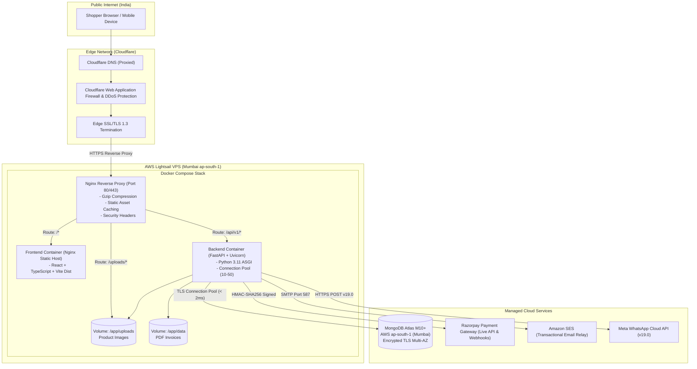

# SREE SAI KRISHNA COLLECTIONS (SSK)
## PRODUCTION HOSTING OPTIONS COMPARISON & ESTIMATED COST ANALYSIS (INR)

**Target Stack:**  
- **Frontend:** React + TypeScript + Vite (Static HTML/JS/CSS served via Nginx)  
- **Backend:** FastAPI (Python 3.11 with Uvicorn ASGI)  
- **Database:** MongoDB Atlas (AWS Mumbai `ap-south-1`)  
- **Reverse Proxy:** Nginx with Gzip & SSL  
- **Packaging:** Docker & Docker Compose  
- **Target Geography:** India (Consumers located across Telangana, Andhra Pradesh, Karnataka, Tamil Nadu, Maharashtra, etc.)  

---

## 1. DETAILED HOSTING PLATFORM COMPARISON MATRIX

| Evaluation Criteria | Option A: AWS Lightsail (Recommended for SSK) | Option B: DigitalOcean Droplet (Bangalore) | Option C: Render (PaaS) | Option D: AWS EC2 (t4g.small / t3.small) |
| :--- | :--- | :--- | :--- | :--- |
| **Instance Specs** | 2 vCPU, 2 GB RAM, 60 GB NVMe SSD | 1 vCPU, 2 GB RAM, 50 GB NVMe SSD | 1 Web Service (FastAPI) + 1 Static Site (Vite) | 2 vCPU (ARM Graviton2), 2 GB RAM, 30 GB EBS |
| **Data Center Location** | **Mumbai (`ap-south-1`)** | **Bangalore (`blr1`)** | Frankfurt / Singapore / US (No India region) | **Mumbai (`ap-south-1`)** |
| **Network Latency to India** | **Ultra-low (5–18 ms)** | **Ultra-low (8–22 ms)** | High (80–180 ms cross-border) | **Ultra-low (5–18 ms)** |
| **Monthly Compute Cost** | **$10 / month (≈ ₹840 / month)** | **$12 / month (≈ ₹1,008 / month)** | $14 / month (≈ ₹1,176 / month) | $15–$18 / month (≈ ₹1,260–₹1,510 / mo) |
| **Bandwidth Allowance** | **3 TB / month included** | 2 TB / month included | 100 GB included (Overage: $0.10/GB) | Pay-as-you-go ($0.09/GB egress) |
| **Database Connectivity** | Same AWS VPC / Region as Atlas Mumbai (< 2ms) | Public transit to Atlas Mumbai (~12ms) | High cross-border latency to Atlas Mumbai | Same AWS VPC peering (< 1ms) |
| **SSL / TLS Termination** | Automated via Certbot (Free Let's Encrypt) | Automated via Certbot (Free Let's Encrypt) | Automated Managed SSL | Automated via Certbot or AWS ALB |
| **Docker Compose Support** | **Full Native Support** | **Full Native Support** | Fragmented (Requires separate PaaS services) | **Full Native Support** |
| **Deployment Complexity** | **Low** (Single Ubuntu VPS running Compose) | **Low** (Single Ubuntu VPS running Compose) | Medium (Dual service configuration) | Medium/High (VPC, Security Groups, IAM) |
| **Backup & Snapshots** | Automated daily instance snapshot (≈ ₹150/mo) | Automated weekly backup (≈ ₹200/mo) | Not applicable to ephemeral containers | EBS Volume Snapshots (≈ ₹180/mo) |
| **TOTAL ESTIMATED MONTHLY COST** | **₹990 – ₹1,100 / month** | **₹1,200 – ₹1,350 / month** | **₹1,400 – ₹1,800 / month** | **₹1,500 – ₹2,000 / month** |

---

## 2. GRANULAR COST CLASSIFICATION & FINANCIAL BREAKDOWN (INDIAN RUPEES)

### A. Fixed Monthly Costs (Baseline Infrastructure)
These costs are incurred regardless of sales volume to keep the storefront, admin portal, and database operational:
- **Application Server (AWS Lightsail Mumbai):** $10.00 / month = **₹840.00 / month**
  - Includes 2 vCPU, 2 GB RAM, 60 GB NVMe SSD, and 3,000 GB (3 TB) data transfer.
- **Dedicated Database (MongoDB Atlas M10 Replica Set):** ~$57.00 / month = **₹4,788.00 / month**
  - Includes 2 GB RAM, 10 GB storage, high-availability multi-AZ failover.
  - *(Optional Pilot Alternative: Shared M2/M5 tier costs ₹750–₹2,100 / month during initial launch).*
- **Domain Registration & Managed DNS:** ~$1.00 / month = **₹84.00 / month** (Annual `.com` renewal ~$12/yr).
- **Subtotal Fixed Infrastructure:** **₹5,712.00 / month**

### B. Usage-Dependent Variable Costs (Per-Order & Traffic Scaling)
These costs scale dynamically with order volume and customer engagement:
- **WhatsApp Utility Messaging (Meta Cloud API):**
  - First 1,000 service conversations per month are **FREE**.
  - Subsequent business-initiated utility conversations in India: **~₹0.78 per conversation** (24-hour customer window).
  - *Example at 500 orders/month (1,000 notifications):* ~500 conversations = **₹0.00 (within free tier)**.
  - *Example at 2,000 orders/month (4,000 notifications):* ~2,000 conversations = **~₹780.00 / month**.
- **Transactional Email (Amazon SES):**
  - First 62,000 emails per month sent from AWS compute are **FREE**.
  - Thereafter: $0.10 per 1,000 emails (~₹8.40 per 1,000 emails).
  - *Expected cost for under 50,000 monthly customer emails:* **₹0.00 / month**.
- **Payment Gateway Processing Fees (Razorpay):**
  - Standard India Domestic Rates: **2.0% + GST per successful transaction** for Cards/Net Banking; **0% fee for UPI** under Indian NPCI guidelines. (Deducted at settlement, not an upfront server cost).

### C. Backup & Storage Costs
- **Server Instance Automated Snapshots (AWS Lightsail):** ~$1.50 / month = **₹126.00 / month** (Retains 7 daily rolling system images).
- **Continuous Atlas Backup Oplogs:** Included in M10 cluster tier base price.

### D. Taxes & Surcharges (Indian GST)
- **Applicable Tax:** Under Indian GST legislation, cloud computing and SaaS services imported from foreign entities or billed by AWS Cloud India are subject to **18% Integrated Goods and Services Tax (IGST)**.
- **Estimated 18% GST on Cloud Infrastructure:**
  - 18% on ₹5,838 base = **₹1,050.84 / month**.
  - *(Note: If the business has an active GSTIN registered, this 18% GST can be claimed back as Input Tax Credit (ITC) against output GST collected on jewellery sales).*

### E. Comprehensive Monthly Cost Summary Table
```
+------------------------------------+------------------+-------------------+
| Expense Category                   | USD Equivalent   | Cost in INR (₹)   |
+------------------------------------+------------------+-------------------+
| Fixed Server & Database            | $68.00           | ₹5,712.00         |
| Backups & Snapshots                | $1.50            | ₹126.00           |
| Variable Email (under 50k sends)   | $0.00            | ₹0.00             |
| Variable WhatsApp (up to 1,000)    | $0.00            | ₹0.00             |
| Estimated 18% GST (Tax)            | $12.51           | ₹1,050.84         |
+------------------------------------+------------------+-------------------+
| TOTAL MONTHLY CASH OUTFLOW         | ~$82.01 / month  | ≈ ₹6,888.84 / mo  |
| (With Input Tax Credit on GST)     | ~$69.50 / month  | ≈ ₹5,838.00 / mo  |
+------------------------------------+------------------+-------------------+
```

> **IMPORTANT PRICING & QUOTATION DISCLAIMER:**  
> The figures presented above are engineering budgetary estimates calculated using published cloud provider pricing schedules as of October 2026 (assuming an exchange rate of 1 USD = 84.00 INR). They **do not constitute binding commercial price quotations** from Amazon Web Services Inc., MongoDB Inc., or Meta Platforms Inc. Actual monthly bills will vary based on real traffic volumes, currency exchange fluctuations, bandwidth overage, and specific merchant discount agreements.

---

## 3. RECOMMENDED PRODUCTION ARCHITECTURE

### Architecture Blueprint


### Why This Architecture is Ideal for Sree Sai Krishna Collections:
1. **Colocated in Mumbai (`ap-south-1`):** Both the AWS Lightsail compute instance and the MongoDB Atlas database cluster sit in Mumbai. Internal network round-trip time between FastAPI and MongoDB is under 2 milliseconds, ensuring lightning-fast product search, cart operations, and checkout.
2. **Fixed, Predictable Pricing:** Unlike raw AWS EC2 where network egress and NAT gateways can create surprise bills, AWS Lightsail includes 3 TB of outbound transfer for a flat $10/month (₹840/month).
3. **Zero Vendor Lock-in (Docker Compose):** Because the stack is packaged in standard Docker containers with Nginx, the entire application can be migrated in under 30 minutes to DigitalOcean, Linode, or bare-metal servers without code modifications.
4. **Resilient Local Volume Mounts:** Product photos and generated invoice PDFs are stored on persistent host volumes, guaranteeing that container updates and code deployments never erase customer invoices or uploaded jewellery photography.
