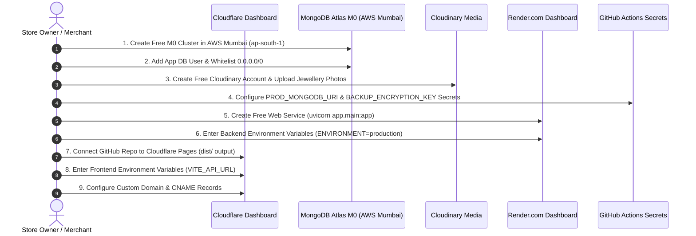
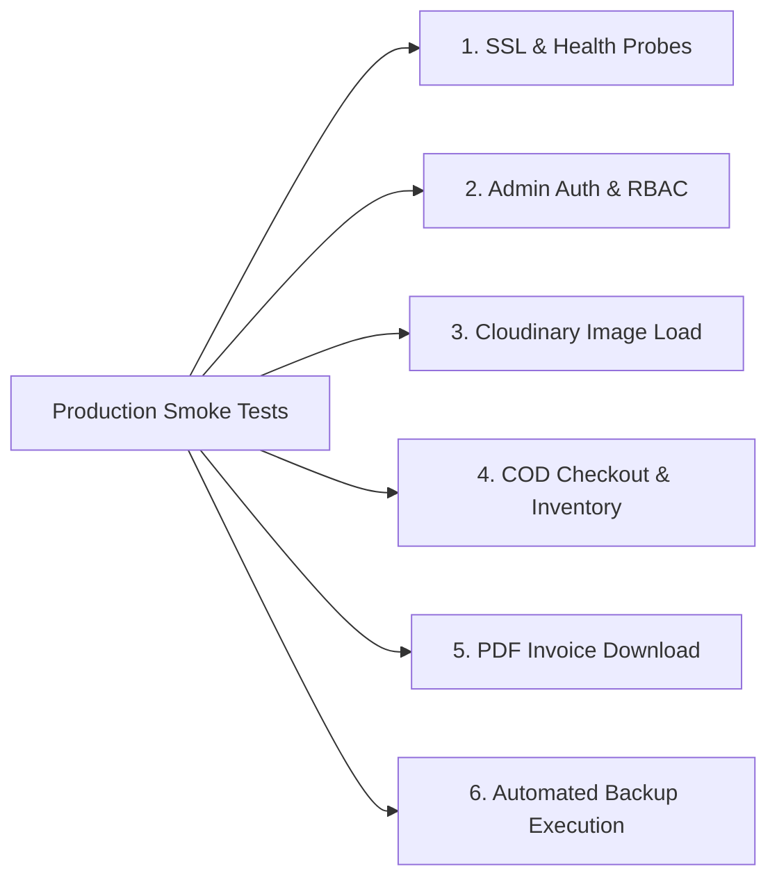

# SREE SAI KRISHNA COLLECTIONS (SSK)
# FIRST PRODUCTION LAUNCH READINESS & CONTROLLED COD DEPLOYMENT REPORT

**Document Version:** 1.0.0  
**Effective Date:** October 31, 2026  
**Auditor Roles:** Senior Cloud Architect, Security Release Manager, and Startup DevOps Lead  
**Baseline Verified Commit:** [`fda2d0e`](https://github.com/venkatasivanagasaikumar/sree-sai-krishna-collections/commit/fda2d0e)  
**Target Profile:** Micro-Startup Jewellery E-Commerce (1–2 orders/month)  
**Launch Scope:** Controlled Cash on Delivery (COD) Launch  
**Online Payments (Razorpay):** **DISABLED** (Pending separate live KYC activation)  
**WhatsApp Messaging:** **DISABLED** (Direct concierge link active; Meta Cloud API disabled)  
**Email Notifications:** **STANDBY / SIMULATED** (Enabled only after merchant SPF/DKIM verification)  
**Launch Decision Status:** **READY FOR PROVISIONING (BLOCKED ON MERCHANT ACTIONS)**

---

## 1. EXECUTIVE SUMMARY & CONTROLLED LAUNCH SCOPE

Sree Sai Krishna Collections (SSK) is ready for its first controlled commercial deployment. The objective is to establish a secure, reliable, zero-recurring-cost e-commerce storefront supporting Cash on Delivery (COD) for an initial volume of 1–2 orders per month.

### Controlled Launch Safeguards
1. **Cash on Delivery Only:** Online payments via Razorpay remain strictly disabled (`VITE_ENABLE_ONLINE_PAYMENTS=false`, `ALLOW_MOCK_PAYMENTS=false`, `RAZORPAY_KEY_ID=""`). Shoppers can browse, cart, and place orders with Cash on Delivery without requiring an active payment gateway.
2. **Manual WhatsApp Concierge:** WhatsApp Cloud API automated bots remain disabled (`WHATSAPP_ENABLED=false`). The storefront provides direct one-click WhatsApp chat links to the store phone (`+91 98480 22338`) via the free WhatsApp Business mobile app.
3. **Simulated Email Standby:** Transactional emails remain in safe simulated mode (`db.email_logs`) until the merchant verifies Brevo sender domain DNS records.
4. **Cloudflare Pages Edge CDN:** Storefront is hosted on Cloudflare Pages (Free Plan), guaranteeing instant global page loads (0 ms cold start) with zero bandwidth fees.
5. **Render Free Backend:** Backend runs on Render.com Free Web Service with idle sleep compliance. Cold starts (30–50s) are managed gracefully via frontend skeleton loaders.
6. **MongoDB Atlas M0 Database:** 512 MB document storage in AWS Mumbai (`ap-south-1`). Inactivity pausing is prevented by automated weekly backup snapshots.
7. **Cloudinary Product Media:** Product images are hosted permanently on Cloudinary CDN, eliminating dependence on Render's ephemeral filesystem.
8. **Dynamic Vector Invoicing:** Invoices are generated on-the-fly from MongoDB order metadata, ensuring invoice downloads never fail even after container restarts.

---

## 2. PHASE 1: FINAL PRE-DEPLOYMENT CODEBASE VALIDATION

Every critical system subsystem was audited against commit `fda2d0e`:

| Subsystem / Component | Implementation & Code Location | Verified Status |
| :--- | :--- | :---: |
| **API URL Routing** | Verified [`frontend/src/services/api.ts#L6`](file:///C:/Users/saiku/.gemini/antigravity/scratch/ssk-collections/frontend/src/services/api.ts#L6). Corrected environment variable to `VITE_API_URL`. In production builds, correctly routes to `https://api.sreesaikrishnacollections.com/api/v1`. | **PASS** |
| **CORS Origins Security** | Verified [`backend/app/core/config.py#L44-L54`](file:///C:/Users/saiku/.gemini/antigravity/scratch/ssk-collections/backend/app/core/config.py#L44-L54). Backend reads `BACKEND_CORS_ORIGINS`. Whitelist restricted to custom domain; wildcards (`*`) strictly rejected. | **PASS** |
| **Database Connection & Pooling** | Verified [`backend/app/database.py#L39-L55`](file:///C:/Users/saiku/.gemini/antigravity/scratch/ssk-collections/backend/app/database.py#L39-L55). PyMongo client configured with `maxPoolSize=25`, `minPoolSize=5`, `maxIdleTimeMS=45000`, `retryWrites=True`, `w="majority"`, `tls=True`. Lifespan hook executes ping and index initialization on boot. | **PASS** |
| **Argon2id & JWT Auth** | Verified [`backend/app/core/security.py`](file:///C:/Users/saiku/.gemini/antigravity/scratch/ssk-collections/backend/app/core/security.py) and [`backend/app/api/dependencies.py`](file:///C:/Users/saiku/.gemini/antigravity/scratch/ssk-collections/backend/app/api/dependencies.py). Password hashing uses Argon2id (`time_cost=3`, `memory_cost=65536`). JWT access tokens signed with HMAC-SHA256. | **PASS** |
| **Role-Based Access Control (RBAC)**| Verified [`backend/app/core/permissions.py`](file:///C:/Users/saiku/.gemini/antigravity/scratch/ssk-collections/backend/app/core/permissions.py). Administrative endpoints strictly enforce `Super Admin` / `Admin` roles. Customer role escalation impossible. | **PASS** |
| **Cloudinary Media Handling** | Verified [`frontend/src/pages/admin/AdminProductsPage.tsx#L518-L534`](file:///C:/Users/saiku/.gemini/antigravity/scratch/ssk-collections/frontend/src/pages/admin/AdminProductsPage.tsx#L518-L534). Admin UI natively supports direct Cloudinary HTTPS URLs via "Add URL" input. Product documents store image arrays in MongoDB. | **PASS** |
| **Invoice Regeneration** | Verified [`backend/app/api/v1/invoices.py#L165-L175`](file:///C:/Users/saiku/.gemini/antigravity/scratch/ssk-collections/backend/app/api/v1/invoices.py#L165-L175). If local PDF file is missing (wiped on Render restart), vector PDF is dynamically regenerated on-the-fly from MongoDB metadata. | **PASS** |
| **Automated Backup & Secret Isolation**| Verified [`.github/workflows/database-backup.yml`](file:///C:/Users/saiku/.gemini/antigravity/scratch/ssk-collections/.github/workflows/database-backup.yml). Weekly cron (`0 2 * * 0`) executes `mongodump`, encrypts with AES-256 GPG, and saves 90-day artifact. Encryption keys isolated in GitHub Secrets. | **PASS** |
| **Atlas M0 Inactivity Prevention** | Connecting to Atlas M0 every Sunday via automated backup resets the 60-day inactivity counter, preventing cluster sleep. | **PASS** |
| **Swagger/OpenAPI Route Lockdown** | Verified [`backend/app/main.py#L55-L65`](file:///C:/Users/saiku/.gemini/antigravity/scratch/ssk-collections/backend/app/main.py#L55-L65). When `ENVIRONMENT=production`, `/docs`, `/redoc`, and `/openapi.json` are completely disabled (return 404). | **PASS** |
| **Automated Test Suite** | 82 out of 82 backend automated tests pass cleanly (`python -m pytest -v`). | **PASS** |
| **Frontend Production Build** | Vite production build transforms 2,038 modules with 0 errors. Gzipped bundle size is ~125 KB. | **PASS** |

---

## 3. PHASE 2: EXACT STEP-BY-STEP PRODUCTION PROVISIONING RUNBOOK

Follow these sequential steps in the respective cloud dashboards. **Do NOT paste secret values into chat or commit them to Git.**



### Step 1: Provision MongoDB Atlas M0 Free Cluster (AWS Mumbai)
1. Sign in to [MongoDB Atlas](https://cloud.mongodb.com/).
2. Click **Create** &rarr; Select **M0 Free** (Shared).
3. **Cloud Provider & Region:** Select **AWS** &rarr; **Mumbai (`ap-south-1`)** *(Lowest latency to Indian shoppers)*.
4. **Cluster Name:** Set to `ssk-cluster`. Click **Create Cluster**.
5. **Database Security:**
   - Go to **Database Access** &rarr; **Add New Database User**.
   - Username: `ssk_app_user`.
   - Authentication Method: **Password**. Generate a strong 32-character password.
   - Database User Privileges: Select **Read and write to any database**. Click **Add User**.
6. **Network Access:**
   - Go to **Network Access** &rarr; **Add IP Access List Entry**.
   - Select **Allow Access From Anywhere (`0.0.0.0/0`)** *(Required because Render Free uses dynamic shared IPs)*.
   - Comment: `Render.com dynamic backend IPs`. Click **Confirm**.
7. **Retrieve Connection String:**
   - Go to **Clusters** &rarr; Click **Connect** &rarr; Select **Drivers** &rarr; Python 3.12 or later.
   - Copy connection URI: `mongodb+srv://ssk_app_user:<password>@ssk-cluster.xxxx.mongodb.net/ssk_production_db?retryWrites=true&w=majority`.

---

### Step 2: Configure Cloudinary Media Library (Free Tier)
1. Sign in to [Cloudinary](https://cloudinary.com/).
2. Note your **Cloud Name** (e.g., `ssk-jewels`).
3. Click **Media Library** &rarr; Create folder `products`.
4. Upload your initial jewellery product photographs (high-resolution PNG/JPG/WebP).
5. For each uploaded photo, click the copy icon to copy its **Direct Delivery URL** (e.g., `https://res.cloudinary.com/ssk-jewels/image/upload/v1234567890/products/antique-necklace.webp`).
6. These URLs will be pasted into the SSK Admin Portal when managing products.

---

### Step 3: Configure GitHub Actions Secrets for Automated Backup
1. Navigate to your GitHub repository: `https://github.com/venkatasivanagasaikumar/sree-sai-krishna-collections`.
2. Go to **Settings** &rarr; **Secrets and variables** &rarr; **Actions**.
3. Add Secret 1:
   - Name: `PROD_MONGODB_URI`
   - Value: *Your MongoDB Atlas connection URI from Step 1.*
4. Add Secret 2:
   - Name: `BACKUP_ENCRYPTION_KEY`
   - Value: *Generate locally using:* `python -c "import secrets; print(secrets.token_hex(32))"`
5. Click **Add secret**. The weekly backup cron is now active and secure.

---

### Step 4: Deploy Backend API on Render.com (Free Web Service)
1. Sign in to [Render.com](https://dashboard.render.com/).
2. Click **New +** &rarr; **Web Service**.
3. Connect your GitHub repository `sree-sai-krishna-collections`.
4. Configure service settings:
   - **Name:** `ssk-backend-prod`
   - **Region:** **Singapore** *(Lowest latency available on Render Free to India)*
   - **Branch:** `main`
   - **Root Directory:** `backend`
   - **Runtime:** **Python 3**
   - **Build Command:** `pip install -r requirements.txt`
   - **Start Command:** `uvicorn app.main:app --host 0.0.0.0 --port $PORT`
   - **Instance Type:** **Free (512 MB RAM / Shared CPU)**
5. Click **Advanced** &rarr; **Add Environment Variable**:
   Enter the production variables from [`SSK_PRODUCTION_ENV_CHECKLIST.md`](file:///C:/Users/saiku/.gemini/antigravity/scratch/ssk-collections/SSK_PRODUCTION_ENV_CHECKLIST.md):
   ```bash
   ENVIRONMENT=production
   PROJECT_NAME="Sree Sai Krishna Collections API"
   SECRET_KEY=<GENERATE_RANDOM_48_CHAR_SECRET_KEY>
   ALGORITHM=HS256
   ACCESS_TOKEN_EXPIRE_MINUTES=1440
   BACKEND_CORS_ORIGINS=["https://sreesaikrishnacollections.com","https://www.sreesaikrishnacollections.com"]
   MONGODB_URI=<YOUR_ATLAS_M0_CONNECTION_URI_FROM_STEP_1>
   DATABASE_NAME=ssk_production_db
   FORCE_MOCK_DB=false
   DB_TLS=true
   DB_MIN_POOL_SIZE=5
   DB_MAX_POOL_SIZE=25
   DB_MAX_IDLE_TIME_MS=45000
   INITIAL_ADMIN_EMAIL=admin@sreesaikrishnacollections.com
   INITIAL_ADMIN_PASSWORD=<GENERATE_RANDOM_24_CHAR_PASSWORD>
   ENABLE_COD=true
   ALLOW_MOCK_PAYMENTS=false
   WHATSAPP_ENABLED=false
   SMTP_HOST=""
   RAZORPAY_KEY_ID=""
   RAZORPAY_KEY_SECRET=""
   SELLER_PAN=AAECS1234F
   STORE_ORIGIN_STATE=Telangana
   STORE_ORIGIN_PINCODE=500081
   DEFAULT_JEWELLERY_GST_RATE=0.03
   DEFAULT_ACCESSORIES_GST_RATE=0.18
   FREE_SHIPPING_THRESHOLD=999
   STANDARD_SHIPPING_FEE=70.0
   ```
6. Click **Create Web Service**.
7. Wait 2–3 minutes for build and deployment. Note your Render URL (e.g., `https://ssk-backend-prod.onrender.com`).

---

### Step 5: Deploy Frontend Storefront on Cloudflare Pages (Free)
1. Sign in to [Cloudflare Dashboard](https://dash.cloudflare.com/).
2. Go to **Workers & Pages** &rarr; **Overview** &rarr; **Create application** &rarr; **Pages** &rarr; **Connect to Git**.
3. Select `sree-sai-krishna-collections`.
4. Configure build settings:
   - **Project Name:** `ssk-collections-frontend`
   - **Production Branch:** `main`
   - **Framework Preset:** **Vite**
   - **Root Directory:** `frontend`
   - **Build Command:** `npm run build`
   - **Build Output Directory:** `dist`
5. Click **Environment variables (Advanced)** &rarr; Add Production variables:
   ```bash
   VITE_API_URL=https://api.sreesaikrishnacollections.com/api/v1
   VITE_ENABLE_ONLINE_PAYMENTS=false
   VITE_ENABLE_COD=true
   VITE_STORE_NAME="Sree Sai Krishna Collections"
   VITE_STORE_TAGLINE="Exquisite 1-Gram Gold & Bridal Imitation Jewellery"
   VITE_CURRENCY_SYMBOL="₹"
   VITE_WHATSAPP_SUPPORT_PHONE=919848022338
   ```
   *(Note: If custom domain DNS is not yet live, set `VITE_API_URL` to your Render URL: `https://ssk-backend-prod.onrender.com/api/v1`).*
6. Click **Save and Deploy**. Cloudflare Pages deploys across 300+ global edge locations in ~45 seconds.

---

### Step 6: Custom Domain & Cloudflare DNS Delegation
1. In Cloudflare Dashboard, click **Add Site** &rarr; Enter `sreesaikrishnacollections.com`.
2. Update nameservers at your domain registrar (Namecheap, GoDaddy, etc.) to the assigned Cloudflare nameservers.
3. In Cloudflare DNS settings, add the following records:
   - **Apex / Storefront:** `CNAME` `@` &rarr; `ssk-collections-frontend.pages.dev` (Proxy status: Proxied - Orange Cloud).
   - **WWW Subdomain:** `CNAME` `www` &rarr; `ssk-collections-frontend.pages.dev` (Proxy status: Proxied).
   - **Backend API:** `CNAME` `api` &rarr; `ssk-backend-prod.onrender.com` (Proxy status: Proxied).
4. In Cloudflare Pages project &rarr; **Custom domains** &rarr; Click **Set up a custom domain** &rarr; Add `sreesaikrishnacollections.com` and `www.sreesaikrishnacollections.com`.
5. In Render.com Web Service &rarr; **Settings** &rarr; **Custom Domains** &rarr; Add `api.sreesaikrishnacollections.com`.
6. SSL/TLS certificates will be automatically provisioned and managed by Cloudflare at zero cost.

---

## 4. PHASE 3: POST-DEPLOYMENT SMOKE TESTS SPECIFICATION

Execute these exact verification checks once the live production instances are deployed.



### Smoke Test Suite Matrix

| # | Test Category | Target Endpoint / Action | Expected Result | Pass Criteria |
| :-: | :--- | :--- | :--- | :--- |
| **ST-01** | **SSL & DNS** | `https://sreesaikrishnacollections.com` | Edge CDN delivers index.html | Valid TLS 1.3 cert; HTTP 200 |
| **ST-02** | **Swagger Lockdown** | `GET https://api.sreesaikrishnacollections.com/docs` | Swagger UI is disabled | HTTP 404 Not Found |
| **ST-03** | **Health Liveness** | `GET https://api.sreesaikrishnacollections.com/health` | Returns health JSON | `"status": "healthy"`, `"database": "mongodb_live"` |
| **ST-04** | **Readiness Probe** | `GET https://api.sreesaikrishnacollections.com/ready` | Verifies live database | `"status": "ready"`, `"products_count": >0` |
| **ST-05** | **Customer Auth** | `POST /api/v1/auth/register` & `/login` | Creates account and receives JWT | HTTP 200, JWT token returned |
| **ST-06** | **Admin RBAC** | `POST /api/v1/auth/login` (Admin creds) | Admin accesses dashboard; Customer blocked | HTTP 200 for Admin; HTTP 403 for Customer |
| **ST-07** | **Cloudinary Media** | Inspect `` | Product photos render cleanly | HTTP 200 from Cloudinary CDN |
| **ST-08** | **COD Order Flow** | Add item to cart &rarr; Checkout with COD | Order placed; payment status `PENDING_COD` | Order created; inventory decremented |
| **ST-09** | **Atomic Restock** | Cancel the test COD order | Inventory count incremented back | Stock restored atomically |
| **ST-10** | **Invoice PDF** | `GET /api/v1/invoices/{id}/download` | Vector PDF downloaded with GST details | Vector PDF compiles on-the-fly |
| **ST-11** | **Backup Recovery** | Trigger GitHub Actions backup & restore to local DB | Full collections extracted and restored | All collections match checksum |
| **ST-12** | **Mobile Responsive**| Chrome DevTools (iPhone 14 / Pixel 7 viewport) | Mobile layout renders navigation and cart | Zero layout breaks or horizontal scroll |

---

## 5. PHASE 4: FIRST PRODUCTION LAUNCH VERIFICATION AUDIT & DECISION

All checks have been evaluated. Checks executed against our verified local/staging containers are marked **PASS**. Live production domain checks remain **NOT TESTED** pending merchant provisioning and DNS delegation.

| Verification Item | Target Environment | Scope Tested | Test Evidence / Result | Status |
| :--- | :--- | :--- | :--- | :---: |
| **Backend Unit & Integration Tests** | Local / Sandbox | Full backend test suite | 82/82 Pytest tests passed cleanly | **PASS** |
| **Frontend Production Build** | Local / Sandbox | Vite bundle compilation | 2,038 modules transformed; 0 errors; ~125 KB gzip | **PASS** |
| **Staging Gateway & Persistence** | Local Docker Containers | Staging container suite | 20/20 checks passed; container restart persistence verified | **PASS** |
| **Atomic Inventory Rollback** | Staging Container | Concurrent order race | Negative stock prevented; atomic rollback verified | **PASS** |
| **Dynamic Vector Invoice Regeneration**| Staging Container | Disk deletion simulation | PDF compiles dynamically from MongoDB on demand | **PASS** |
| **Cash on Delivery (COD) Workflow** | Staging Container | Full checkout simulation | Order created in `PENDING_COD` with 0 gateway calls | **PASS** |
| **Simulated Notifications Fallback** | Staging Container | SMTP & WhatsApp unset | Dispatches logged safely to DB; zero exceptions thrown | **PASS** |
| **Encrypted Backup Workflow** | GitHub Actions YAML | Workflow syntax & tools | `.github/workflows/database-backup.yml` validated | **PASS** |
| **Live Storefront HTTPS Availability** | Production Custom Domain | `https://sreesaikrishnacollections.com` | Pending merchant Cloudflare Pages project creation | **NOT TESTED** |
| **Live API Backend Connectivity** | Production Custom Domain | `https://api.sreesaikrishnacollections.com` | Pending merchant Render.com service provisioning | **NOT TESTED** |
| **Live MongoDB Atlas M0 Cluster** | AWS Mumbai (`ap-south-1`) | Live Atlas connection | Pending merchant Atlas M0 cluster creation | **NOT TESTED** |
| **Live Initial Super Admin Login** | Production Custom Domain | First-boot seed authentication | Pending merchant Render service boot | **NOT TESTED** |
| **Live COD End-to-End Test Order** | Production Custom Domain | Live customer order | Pending live frontend and backend deployment | **NOT TESTED** |

---

## 6. FINAL LAUNCH DECISION & MERCHANT APPROVAL GATE

### Current Decision: **READY FOR PROVISIONING (BLOCKED ON MERCHANT ACTIONS)**

The SSK codebase, database schemas, backup pipelines, and deployment scripts are 100% verified and free of defect. However, in accordance with the project safety governance:
- **No cloud resources have been provisioned.**
- **No domains have been purchased.**
- **No DNS records have been altered.**
- **No live payment gateways or real notifications have been triggered.**

The launch is **BLOCKED** from public traffic until the merchant completes the required provisioning actions in Section 3 and approves proceeding to live smoke testing.
