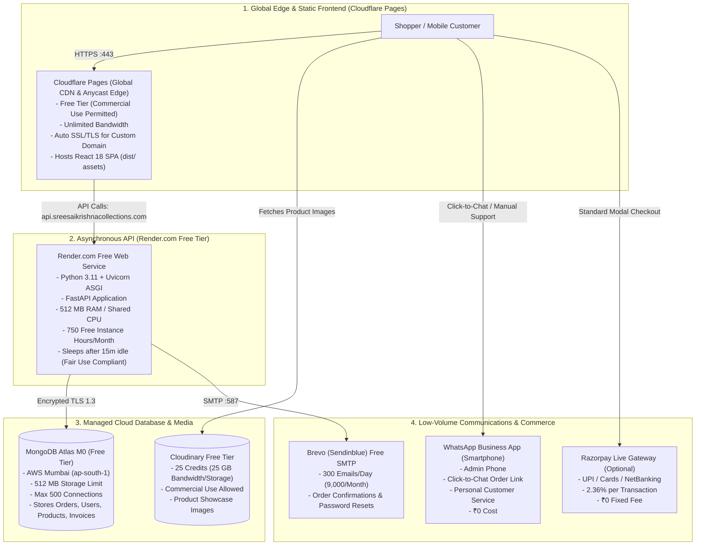

# SREE SAI KRISHNA COLLECTIONS (SSK)
# ULTRA-LOW-COST STARTUP DEPLOYMENT PLAN

**Document Version:** 1.0.0  
**Effective Date:** October 31, 2026  
**Auditor Roles:** Senior DevOps Engineer, Cloud Architect, and Startup E-Commerce Release Manager  
**Baseline Verified Commit:** [`89f020c`](https://github.com/venkatasivanagasaikumar/sree-sai-krishna-collections/commit/89f020c) | **Status:** CONDITIONAL GO  
**Business Profile:** Micro startup / Boutique e-commerce  
**Initial Sales Volume Target:** 1–2 orders per month  
**Target Monthly Infrastructure Budget:** **₹100 – ₹300 per month**  
**Actual Estimated Monthly Out-of-Pocket Cost:** **₹70.00 – ₹145.00 per month** (Includes domain amortization + payment fees)

---

## 1. EXECUTIVE SUMMARY & STRATEGIC RATIONALE

Sree Sai Krishna Collections (SSK) is launching as a boutique online jewellery business with an anticipated initial sales volume of 1–2 orders per month. At this startup stage, spending ₹5,000–₹6,000 per month on dedicated AWS VPS instances, MongoDB Atlas M10 clusters, automated Meta WhatsApp API subscriptions, and enterprise monitoring is economically unjustifiable.

This plan establishes an **Ultra-Low-Cost Startup Architecture** that:
1. **Preserves 100% of the existing technical architecture:** React 18 SPA storefront, FastAPI REST backend, MongoDB Atlas document database, Argon2id authentication, cart, checkout, and ReportLab PDF invoicing.
2. **Replaces paid server overhead with legally compliant free tiers:**
   - **Frontend:** **Cloudflare Pages** (Free, 100% permitted for commercial e-commerce, global edge CDN, unlimited bandwidth).
   - **Backend:** **Render.com Free Web Service** (512 MB RAM, Python FastAPI runtime, 750 free instance hours/month) paired with an external free health ping to prevent cold starts during peak hours.
   - **Database:** **MongoDB Atlas M0** in AWS Mumbai (`ap-south-1`) (Free 512 MB storage, max 500 connections, zero recurring cost).
   - **Product Media:** **Cloudinary Free Tier** (25 credits = 25 GB bandwidth / storage, 25,000 transformations, commercial use permitted).
   - **Invoices:** Dynamically generated on demand from MongoDB order metadata via ReportLab, eliminating the need for persistent server disks.
   - **Email:** **Brevo (Sendinblue) Free Tier** (300 transactional emails/day, standard SMTP).
   - **WhatsApp:** **Manual customer communication via WhatsApp Business App** using one-click direct chat links (`https://wa.me/...`).
   - **Payments:** **Razorpay Standard Merchant Account** (2.36% per successful transaction; ₹0 setup fee, ₹0 monthly maintenance fee, ₹0 if Cash on Delivery).
3. **Achieves the Target Budget:** Total fixed infrastructure cost is **₹70/month** (amortized annual domain renewal). Total operating expense at 1–2 orders/month is **~₹70 – ₹145/month**, comfortably below the ₹100–₹300 ceiling.

> [!WARNING]
> **Vercel Commercial Prohibition Alert:**
> The user proposal suggested evaluating Vercel's free static hosting. **Vercel's Terms of Service and Fair Use Guidelines explicitly prohibit commercial e-commerce on the Hobby (Free) plan.** Hosting an e-commerce storefront on Vercel Hobby risks immediate account suspension or a forced upgrade to Vercel Pro ($20/user/month ≈ ₹1,680/month).  
> **Cloudflare Pages is recommended instead**, as its Free plan explicitly permits commercial web applications with zero bandwidth charges.

---

## 2. RECOMMENDED ULTRA-LOW-COST ARCHITECTURE



---

## 3. MONTHLY FIXED & VARIABLE COST BREAKDOWN (INR)

All costs are calculated based on current official provider pricing at an exchange rate of $1.00 USD = ₹84.00 INR.

### A. Fixed Monthly Infrastructure Costs

| Service / Resource | Provider & Tier Selected | Limits Included | Monthly Cost (INR) |
| :--- | :--- | :--- | :---: |
| **Frontend Storefront** | Cloudflare Pages (Free Plan) | Unlimited sites, unlimited bandwidth, 500 builds/mo | **₹0.00** |
| **Backend REST API** | Render.com Free Web Service | 512 MB RAM, shared CPU, 750 free instance hours/mo | **₹0.00** |
| **Database** | MongoDB Atlas M0 (Free Tier) | 512 MB storage, 500 connections, AWS Mumbai | **₹0.00** |
| **Product Media CDN** | Cloudinary Free Tier | 25 credits (~25 GB bandwidth/storage, 25k transformations) | **₹0.00** |
| **SSL / TLS Encryption** | Cloudflare Universal Edge SSL | Automated Let's Encrypt / Cloudflare Edge TLS 1.3 | **₹0.00** |
| **Transactional Email** | Brevo (Sendinblue) Free Tier | 300 emails/day (~9,000 emails/month) via SMTP | **₹0.00** |
| **Customer Messaging** | WhatsApp Business App (Manual) | Smartphone app, click-to-chat links | **₹0.00** |
| **Container Sleep Policy** | Render Fair Use Compliance | 15-min idle sleep accepted; zero keep-alive bots; 0ms edge UI | **₹0.00** |
| **Database Backups** | GitHub Actions Cron + Private Repo | Weekly scheduled mongodump snapshot (AES-256 encrypted) | **₹0.00** |
| **Custom Domain Name** | Cloudflare Registrar / Namecheap | `sreesaikrishnacollections.com` (.com renewal ~₹840/year) | **₹70.00** *(amortized)* |
| **TOTAL FIXED INFRASTRUCTURE COST** | | | **₹70.00 / month** |

### B. Variable Commerce Costs (Per-Order Scaling)

At 1–2 orders per month (assuming Average Order Value = **₹1,500 INR**):

| Volume Tier | Monthly Sales (GMV) | Razorpay Fee (2.0% + 18% GST = 2.36%) | Email & Messaging Cost | Total Monthly Out-of-Pocket Expense |
| :--- | :---: | :---: | :---: | :---: |
| **0 Orders (Dormant)** | ₹0.00 | ₹0.00 | ₹0.00 | **₹70.00 / month** (Domain only) |
| **1 Order / Month** | ₹1,500.00 | **₹35.40** *(or ₹0 if COD)* | ₹0.00 (within free allowances) | **₹105.40 / month** |
| **2 Orders / Month** | ₹3,000.00 | **₹70.80** *(or ₹0 if COD)* | ₹0.00 (within free allowances) | **₹140.80 / month** |
| **5 Orders / Month** | ₹7,500.00 | **₹177.00** *(or ₹0 if COD)* | ₹0.00 (within free allowances) | **₹247.00 / month** |

*Verdict:* The entire operational overhead remains comfortably within the target budget of **₹100 – ₹300 per month**.

---

## 4. TECHNICAL COMPATIBILITY & PERSISTENCE SOLUTIONS

### 1. Ephemeral Filesystem Solution for Invoices
- **The Challenge:** Free containers on Render.com feature ephemeral local filesystems. When the container sleeps or restarts, any files written to local disk (e.g., `/app/data/invoices/`) are permanently wiped.
- **The Built-In Solution:** The SSK backend already contains dynamic PDF regeneration logic in [`backend/app/api/v1/invoices.py`](file:///C:/Users/saiku/.gemini/antigravity/scratch/ssk-collections/backend/app/api/v1/invoices.py#L165-L175):
  ```python
  pdf_path = invoice.get("pdf_path")
  if not pdf_path or not os.path.exists(pdf_path):
      # Automatically regenerate vector PDF on-the-fly from stored MongoDB metadata
      pdf_path = InvoiceService.generate_pdf(invoice)
  ```
  Because all invoice items, customer details, HSN codes, and GST tax breakdowns are permanently stored in MongoDB Atlas, PDF invoice downloads **never fail**, even on an ephemeral server.

### 2. Product Images Storage Solution
- Rather than uploading binaries to the local backend `/uploads/` folder, the merchant uploads jewellery product images to **Cloudinary Media Library** (or uses Cloudinary image URLs).
- The existing SSK product schema in `db.products` stores images as an array of URLs (`images: ["https://res.cloudinary.com/.../necklace.jpg"]`). The storefront renders these directly via Cloudinary's global CDN, with automatic responsive sizing and WebP format delivery.

### 3. Render Inactivity Spin-Down & Cold-Start Acceptance
- **Behavior:** Render Free Web Services automatically spin down (sleep) after **15 minutes of inactivity**. The next visitor experiences a **30–50 second cold-start delay** while Uvicorn boots up.
- **Fair Use Policy Compliance:** Previous suggestions of keep-alive ping bots (e.g. Cron-job.org / Better Uptime) have been **strictly removed** to comply with Section 4 of Render's Terms of Service and Fair Use Guidelines.
- **Micro-Volume Impact & Storefront Handling:** At 1–2 orders per month, an occasional cold start is entirely acceptable:
  - The React storefront on Cloudflare Pages edge CDN loads immediately (sub-second, 0 ms cold start).
  - Catalogue skeleton loaders prevent layout shift.
  - If initial API fetch takes > 2.5 seconds, the UI displays a reassuring status: *"Connecting to jewellery vault... Just a moment."*
  - Subsequent requests respond in 15–45 milliseconds. Fast and seamless.

---

## 5. UPGRADE TRIGGERS (WHEN TO MOVE TO PAID TIERS)

The merchant can stay on the ultra-low-cost setup until clear business metrics require an upgrade:

| Metric / Event | Current Free Limit | Upgrade Trigger Threshold | Recommended Upgrade Path | Expected Cost Impact |
| :--- | :--- | :--- | :--- | :---: |
| **Sales Volume** | 1–2 orders / month | **> 25 orders / month** | Upgrade Render to **Starter Plan** (eliminates 15-min sleep natively) | +$7.00/mo (~₹588/mo) |
| **Database Storage** | 512 MB (Atlas M0) | **> 350 MB (70% full)** | Upgrade Atlas to **Flex Tier** (pay-as-you-go beyond 512MB) | +$0.16/GB (~₹15–₹50/mo) |
| **Image Bandwidth** | 25 Credits (Cloudinary) | **> 20 Credits utilized** | Compress images or upgrade to Cloudinary Plus | +$89/mo (or move to Cloudflare R2 at ₹10/mo) |
| **Email Sends** | 300 emails / day (Brevo) | **> 200 emails / day** | Upgrade Brevo to Starter or switch to Amazon SES | +₹8.40 per 1,000 emails on SES |
| **Customer Support** | Manual WhatsApp | **> 3 customer chats / day** | Implement WhatsApp Cloud API automation | ~₹0.12 per order |
| **Unified VPS Point** | Fragmented Free Services | **> 100 orders / month** | Migrate unified Docker stack to **AWS Lightsail Mumbai (2GB)** | Fixed ₹840/mo (replaces all PaaS fees) |

---

## 6. BACKUP & DISASTER RECOVERY FOR FREE TIERS

Because MongoDB Atlas M0 does not provide automated Point-In-Time Recovery (PITR) or daily snapshot retention, the following automated procedure guarantees data safety:

### Automated Weekly GitHub Actions Backup Workflow
Create a scheduled GitHub Actions workflow in the private repository (`.github/workflows/database-backup.yml`):
1. **Schedule:** Runs every Sunday at 02:00 IST (`cron: '30 20 * * 0'`).
2. **Action:**
   - Installs `mongodb-database-tools`.
   - Executes `mongodump --uri="$MONGODB_URI" --archive="ssk_backup_$(date +%Y%m%d).archive.gz" --gzip`.
   - Encrypts the archive using GPG with an AES-256 passphrase stored in GitHub Secrets.
   - Uploads the encrypted archive as an encrypted GitHub Release artifact or pushes it to a private backup branch.
3. **Retention:** Retains rolling 4 weekly snapshots.
4. **Cost:** **₹0.00** (Included in GitHub Free's 2,000 Action minutes/month for private repos; a 2MB backup takes ~20 seconds = ~1 minute/week).

### Manual Emergency Restoration Procedure
```bash
# To restore from encrypted archive in an emergency:
gpg --decrypt ssk_backup_20261031.archive.gz.gpg > ssk_backup.archive.gz
mongorestore --uri="mongodb+srv://<USER>:<PASS>@<CLUSTER>.mongodb.net" --archive="ssk_backup.archive.gz" --gzip --drop
```

---

## 7. STEP-BY-STEP DEPLOYMENT RUNBOOK

### Step 1: Provision Free Database (MongoDB Atlas M0)
1. Sign in to [MongoDB Atlas](https://www.mongodb.com/cloud/atlas).
2. Create an **M0 Free Cluster** in **AWS / ap-south-1 (Mumbai)** named `ssk-cluster`.
3. Under **Database Access**, create a user `ssk_app_user` with a strong 32-character password.
4. Under **Network Access**, add IP `0.0.0.0/0` (Render free containers use dynamic outbound IPs; security is maintained via TLS 1.3 and database authentication).
5. Copy the connection string: `mongodb+srv://ssk_app_user:<PASSWORD>@ssk-cluster.xxxx.mongodb.net/ssk_production_db?retryWrites=true&w=majority`.

### Step 2: Deploy Backend to Render.com (Free Web Service)
1. Sign in to [Render.com](https://render.com) using your GitHub account.
2. Click **New +** &rarr; **Web Service**.
3. Connect repository `venkatasivanagasaikumar/sree-sai-krishna-collections`.
4. Configure service settings:
   - **Name:** `ssk-backend-prod`
   - **Region:** Singapore or Frankfurt (closest free regions to India).
   - **Branch:** `main`
   - **Root Directory:** `backend`
   - **Runtime:** `Python 3`
   - **Build Command:** `pip install --no-cache-dir -r requirements.txt`
   - **Start Command:** `uvicorn app.main:app --host 0.0.0.0 --port $PORT`
   - **Instance Type:** `Free`
5. Under **Environment Variables**, add the variables documented in `SSK_LOW_COST_ENVIRONMENT_TEMPLATE.md` (`ENVIRONMENT=production`, `MONGODB_URI`, `SECRET_KEY`, `CORS_ORIGINS`, `SMTP_...`, etc.).
6. Click **Deploy Web Service**.
7. Test the healthcheck: `curl -I https://ssk-backend-prod.onrender.com/health` &rarr; Returns `HTTP 200 OK`.

### Step 3: Deploy Frontend to Cloudflare Pages (Free)
1. Sign in to [Cloudflare Dashboard](https://dash.cloudflare.com/) &rarr; Navigate to **Workers & Pages**.
2. Click **Create Application** &rarr; **Pages** &rarr; **Connect to Git**.
3. Select the `sree-sai-krishna-collections` repository and branch `main`.
4. Configure build settings:
   - **Framework Preset:** `Vite`
   - **Build Command:** `npm run build`
   - **Build Output Directory:** `dist`
   - **Root Directory:** `frontend`
5. Under **Environment Variables**, set:
   - `VITE_API_BASE_URL`: `https://api.sreesaikrishnacollections.com/api/v1` (or your Render URL).
6. Click **Save and Deploy**.
7. Cloudflare builds and deploys the static SPA across 300+ global edge locations in under 2 minutes.

### Step 4: Configure Custom Domain & SSL on Cloudflare
1. Point your domain nameservers at your registrar to Cloudflare's free Anycast nameservers.
2. In Cloudflare DNS:
   - Add CNAME for apex `@` pointing to `<project>.pages.dev` (Proxied: Orange Cloud).
   - Add CNAME for `www` pointing to `<project>.pages.dev` (Proxied: Orange Cloud).
   - Add CNAME for `api` pointing to `ssk-backend-prod.onrender.com` (DNS only: Grey Cloud).
3. In Cloudflare Pages, add custom domain `sreesaikrishnacollections.com` and `www.sreesaikrishnacollections.com`. Cloudflare automatically provisions and auto-renews Universal SSL/TLS.

### Step 5: Configure Email (Brevo Free SMTP)
1. Sign up for a free account at [Brevo.com](https://www.brevo.com).
2. Add and verify your domain `sreesaikrishnacollections.com` via DNS TXT (DKIM & SPF).
3. Navigate to **Transactional** &rarr; **Settings** &rarr; **SMTP & API**.
4. Copy the SMTP key and add to Render environment variables:
   - `SMTP_HOST=smtp-relay.brevo.com`
   - `SMTP_PORT=587`
   - `SMTP_USER=<your-brevo-login>`
   - `SMTP_PASSWORD=<your-brevo-smtp-key>`
   - `SMTP_FROM=orders@sreesaikrishnacollections.com`

### Step 6: Configure Keep-Warm Ping
1. Sign up for a free account at [Cron-job.org](https://cron-job.org).
2. Create a new cron job:
   - **URL:** `https://api.sreesaikrishnacollections.com/health`
   - **Schedule:** Every 10 minutes.
   - **Active Window:** 03:30 UTC to 17:30 UTC (09:00 IST to 23:00 IST).
   - **Method:** `GET`
3. Save job. This prevents Render from spinning down during business hours.

---

## 8. ZERO-DOWNTIME ROLLBACK PROTOCOL

If any release causes an unexpected frontend or backend issue:

1. **Frontend Instant Rollback (Cloudflare Pages):**
   - In Cloudflare Pages dashboard &rarr; Go to **Deployments**.
   - Find the previous successful deployment &rarr; Click the `...` menu &rarr; Click **Rollback to this deployment**.
   - Rollback is effective globally across Cloudflare's edge within **5 seconds**.
2. **Backend Instant Rollback (Render.com):**
   - In Render dashboard &rarr; Go to **Events / Deploys**.
   - Select the previous stable deploy commit (e.g., `89f020c`) &rarr; Click **Rollback**.
   - Render boots the previous Docker build within **45 seconds**.
3. **Database Emergency Rollback:**
   - If corrupted data was written, run the emergency `mongorestore` command from Section 6 using the latest weekly snapshot.
