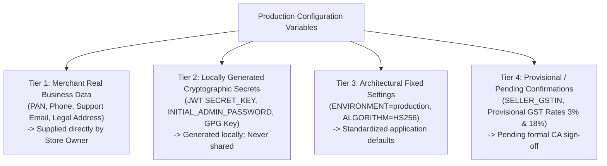
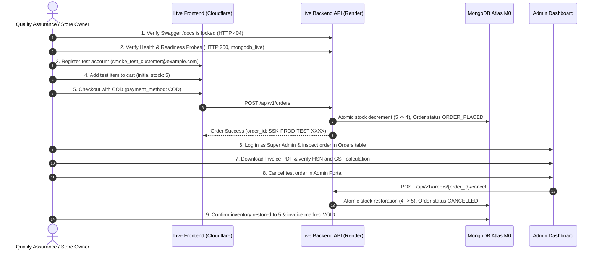

# SREE SAI KRISHNA COLLECTIONS (SSK)
# PRODUCTION ENVIRONMENT VARIABLE CHECKLIST, SECURITY GOVERNANCE & TAX COMPLIANCE RUNBOOK

**Document Version:** 2.0.0  
**Effective Date:** October 31, 2026  
**Auditor Roles:** Senior DevOps Engineer, Cloud Architect, and Security Release Manager  
**Baseline Verified Commit:** [`33c2271`](https://github.com/venkatasivanagasaikumar/sree-sai-krishna-collections/commit/33c2271)  
**Target Architecture:** Cloudflare Pages (Frontend) + Render.com Free Web Service (Backend) + MongoDB Atlas M0 (AWS Mumbai)

---

## 1. CRITICAL SECURITY GUARDRAILS & MONGODB NETWORK ARCHITECTURE

### A. Strict Secrets Governance
> [!CAUTION]
> 1. **ZERO SECRETS IN GIT:** Real production passwords, database URIs, JWT secret keys, and SMTP credentials must **NEVER** be committed to source code or pushed to any Git branch.
> 2. **CONSOLE-ONLY CONFIGURATION:** All variables listed in this document must be configured exclusively in the official cloud provider web consoles:
>    - Frontend variables &rarr; **Cloudflare Dashboard &rarr; Pages &rarr; Settings &rarr; Environment variables**
>    - Backend variables &rarr; **Render Dashboard &rarr; Services &rarr; ssk-backend &rarr; Environment**
> 3. **STAGING ISOLATION:** Never reuse staging database connection strings, credentials, or keys in the production environment.
> 4. **MINIMUM ENTROPY STANDARDS:** Secret keys must be minimum 32 random characters (generated via local Python commands in Section 6).

---

### B. MongoDB Atlas Network Security & Compensating Controls Analysis

#### Why `0.0.0.0/0` Access Rule is Required on Render Free
- **Technical Reality:** On the Render Free Web Service plan, outbound HTTP and database traffic originates from a large, dynamically allocated egress IP pool managed by AWS and GCP infrastructure.
- **No Static Egress IP:** Render does **not** provide dedicated or static outbound IP addresses on its Free plan. Dedicated outbound IPs are available only on paid Enterprise plans or through paid third-party HTTP proxy add-ons (such as QuotaGuard Static or Fixie), which would violate our zero-recurring-cost constraint.
- **Access Rule Impact:** Because outgoing IPs change unpredictably on every container spin-up and deployment, restricting Atlas Network Access to a single static IP or a narrow CIDR range is technically impossible. The Atlas access rule must be set to `0.0.0.0/0` (Allow access from anywhere).

#### Identified Security Risk
Setting `0.0.0.0/0` makes the MongoDB Atlas port (`27017`) reachable over the public internet. If weak credentials were used, the database would be vulnerable to automated brute-force attacks and network port scanners.

#### Seven Compensating Controls (Enforced for SSK)
To mitigate this risk completely, the following mandatory controls are implemented:
1. **Dedicated Least-Privilege Database User:**
   - The application connects using a dedicated application user: `ssk_app_user`.
   - **Strict Scope:** This user is granted **strictly `readWrite` on `ssk_production_db` ONLY**.
   - **Zero Administrative Privileges:** The application user has NO access to `admin`, `config`, or `local` databases, NO `clusterAdmin` privileges, and NO `userAdminAnyDatabase` rights.
   - **Never Use Atlas Admin Credentials:** The primary MongoDB Atlas account username/password (used to manage the cluster at cloud.mongodb.com) must **NEVER** be entered into the application.
2. **High-Entropy Password:** The password for `ssk_app_user` must be minimum 32–48 characters long, generated using a cryptographically secure random source (e.g. `secrets.token_urlsafe(36)`), rendering brute-force or dictionary attacks mathematically infeasible.
3. **Mandatory TLS 1.3 Encryption in Transit:** PyMongo enforces TLS 1.3 (`tls=True` via `mongodb+srv://`), guaranteeing that all data, queries, and authentication handshakes are fully encrypted against network interception.
4. **Strong Authentication Mechanism:** Atlas enforces SCRAM-SHA-256 password hashing.
5. **Console-Level Isolation:** The database URI is stored as an encrypted environment variable in Render's secure secret manager and is never printed in server logs or application responses.
6. **Master Account MFA:** The store owner's Atlas account (cloud.mongodb.com) must have Multi-Factor Authentication (2FA) enabled.
7. **Quarterly Credential Rotation:** The database user password should be rotated every 90 days.

---

## 2. PRODUCTION SECRETS & MERCHANT INFORMATION CLASSIFICATION

To prevent placeholder values from being deployed accidentally, all configuration parameters are explicitly categorized into four distinct tiers:



### Placeholder vs. Real Merchant Data Inventory

| Configuration Key | Previous Value in Docs | Classification Tier | Mandatory Merchant Action Before Launch |
| :--- | :--- | :---: | :--- |
| `SELLER_PAN` | `AAECS1234F` *(Sample Dummy)* | **Tier 1 (Merchant Data)** | **MUST BE REPLACED** with store owner's real 10-character Permanent Account Number. |
| `INITIAL_ADMIN_EMAIL` | `admin@sreesaikrishnacollections.com` | **Tier 1 (Merchant Data)** | **MUST BE REPLACED** with store owner's real administrative email address. |
| `SUPPORT_PHONE` | `+91 98480 22338` | **Tier 1 (Merchant Data)** | Confirm store owner's official customer support WhatsApp phone number. |
| `BUSINESS_ADDRESS` | *Secunderabad sample address* | **Tier 1 (Merchant Data)** | Confirm store's registered business dispatch address. |
| `SECRET_KEY` | `GENERATE_RANDOM_...` | **Tier 2 (Cryptographic)** | **MUST BE GENERATED LOCALLY** via Python `secrets`. Never commit to Git. |
| `INITIAL_ADMIN_PASSWORD` | `REPLACE_WITH_MINIMUM_...` | **Tier 2 (Cryptographic)** | **MUST BE GENERATED LOCALLY** via Python `secrets`. Never commit to Git. |
| `BACKUP_ENCRYPTION_KEY` | `REPLACE_WITH_...` | **Tier 2 (Cryptographic)** | **MUST BE GENERATED LOCALLY** via Python `secrets` for GitHub Actions secret. |
| `MONGODB_URI` | `mongodb+srv://ssk_app_user:...` | **Tier 2 (Cryptographic)** | Generated in Atlas with dedicated password. Entered only in Render console. |
| `SELLER_GSTIN` | `36AAECS1234F1Z5` *(Sample)* | **Tier 4 (Pending CA)** | **LEAVE BLANK OR SET TO REAL GSTIN** only after Chartered Accountant confirms. |
| `DEFAULT_JEWELLERY_GST_RATE`| `0.03` (3%) | **Tier 4 (Pending CA)** | **PROVISIONAL:** 3% is standard for HSN 7117 imitation jewellery; CA must verify. |
| `DEFAULT_ACCESSORIES_GST_RATE`| `0.18` (18%) | **Tier 4 (Pending CA)** | **PROVISIONAL:** 18% is standard for HSN 9615 hair accessories; CA must verify. |

---

## 3. GST & INVOICE COMPLIANCE AUDIT & CA CONFIRMATION CHECKLIST

### Codebase Tax Engine Inspection
In [`backend/app/services/invoice_service.py`](file:///C:/Users/saiku/.gemini/antigravity/scratch/ssk-collections/backend/app/services/invoice_service.py#L123-L130), product HSN codes and GST rates are assigned as follows:
```python
# Automatic HSN and GST rate classification heuristic:
if any(term in name or term in category for term in ["hair", "clip", "claw", "band", "scrunchie"]):
    hsn = "9615"                                      # Hair slides, clips, hairpins, hair curlers
    gst_rate = settings.DEFAULT_ACCESSORIES_GST_RATE  # 18% (Configurable via env)
else:
    hsn = "7117"                                      # Imitation jewellery
    gst_rate = settings.DEFAULT_JEWELLERY_GST_RATE   # 3% (Configurable via env)
```
- **Tax Inclusion:** Product selling prices displayed on the storefront are inclusive of GST. The tax engine automatically reverse-calculates the taxable value: `Taxable Value = Total Price / (1 + GST Rate)`.
- **Intrastate vs Interstate:** For orders shipping within Telangana, tax is split equally into CGST (1.5% or 9%) and SGST (1.5% or 9%). For interstate shipments, the entire tax is levied as IGST (3% or 18%).
- **Current Legal Status:** These rates are based on industry standards for imitation jewellery and plastic accessories, but **they are PROVISIONAL and have NOT yet received formal legal certification from the merchant's Chartered Accountant (CA)**.

### Merchant & Chartered Accountant (CA) Confirmation Checklist
Before issuing invoices to public customers, the store owner must consult their CA to answer and sign off on the following:

- [ ] **Check 1: Threshold Exemption vs. Mandatory E-Commerce GSTIN:**
  - *Context:* Under Section 22 of the CGST Act, standard threshold for GST registration in goods is ₹40 Lakhs. However, Section 24(ix) traditionally mandated compulsory registration for e-commerce sellers. Notification No. 34/2023-Central Tax provides conditional exemption for small e-commerce sellers with turnover < ₹40 Lakhs selling via Electronic Commerce Operators (ECOs).
  - *CA Determination Required:* Can SSK operate on its own independent website initially under PAN only, or must the business obtain a regular GSTIN before dispatching its first interstate parcel?
- [ ] **Check 2: HSN 7117 Tax Rate Confirmation (Imitation Jewellery):**
  - Confirm that 1-gram gold plated jewellery, micro-plated brass sets, and CZ bridal sets qualify strictly under **HSN 7117 (Imitation Jewellery)** at **3% GST** (or whether any item containing silver/gold foils falls under HSN 7113 at different compliance requirements).
- [ ] **Check 3: HSN 9615 Tax Rate Confirmation (Hair Accessories):**
  - Confirm that hair clips, metal clutchers, and rubber scrunchies qualify under **HSN 9615** at **18% GST**.
- [ ] **Check 4: Invoice Disclaimer Requirement:**
  - If operating under PAN without GSTIN during the startup phase, invoices must not charge or display separate GST tax line items; they should be issued as commercial retail bills under PAN until GSTIN is registered. Update `SELLER_GSTIN=""` accordingly.

---

## 4. MONGODB CONNECTION POOL SIZING FOR STARTUP VOLUME

### Resource & Limit Analysis

| Parameter | Previous Suggested | **Corrected Startup Recommendation** | Technical Rationale & Capacity Analysis |
| :--- | :---: | :---: | :--- |
| `DB_MIN_POOL_SIZE` | `5` | **`1`** | Maintains 1 persistent warm socket during idle container life. Saves container memory. |
| `DB_MAX_POOL_SIZE` | `25` | **`5`** | Allows up to 5 concurrent database operations simultaneously. For 1–2 orders/month, 5 connections can effortlessly handle multiple concurrent customer cart/browsing requests without memory pressure. |
| `DB_MAX_IDLE_TIME_MS` | `45000` | **`30000`** | Recycles idle sockets every 30 seconds, preventing stale connections across Render container spin-downs. |
| `DB_CONNECT_TIMEOUT_MS`| `10000` | **`10000`** | 10 seconds initial TCP connect timeout. |
| `DB_SERVER_SELECTION_TIMEOUT_MS`| `5000` | **`5000`** | 5 seconds fail-fast timeout if cluster is unreachable. |

### Why 5 Connections is Optimal:
1. **Atlas M0 Hard Cap:** Atlas M0 permits a maximum of **500 total connections** across all clients. A pool of 5 connections consumes **exactly 1.0%** of the cluster's quota.
2. **Render Free Memory Budget:** Render Free provides **512 MB RAM**. Each MongoDB connection in the driver consumes ~1–2 MB of socket buffers and thread overhead. Restricting the pool to 5 connections keeps total application memory footprint strictly below **190 MB RAM**, leaving over **320 MB headroom** for ReportLab PDF compilation and Uvicorn workers.

---

## 5. FRONTEND & BACKEND ENVIRONMENT VARIABLES SPECIFICATION

### Frontend Environment Variables (Cloudflare Pages Dashboard)

| Variable Name | Required? | Production Value | Classification | Description & Validation Rules |
| :--- | :---: | :--- | :---: | :--- |
| **`VITE_API_URL`** | **MANDATORY** | `https://api.sreesaikrishnacollections.com/api/v1` *(or Render backend URL)* | Tier 3 | **CRITICAL:** API base URL. Do NOT use `VITE_API_BASE_URL`. Must include `/api/v1` suffix and omit trailing slash. |
| `VITE_STORE_NAME` | Optional | `Sree Sai Krishna Collections` | Tier 1 | Brand display name rendered in storefront navigation. |
| `VITE_STORE_TAGLINE` | Optional | `Exquisite 1-Gram Gold & Bridal Imitation Jewellery` | Tier 1 | Hero headline and metadata description. |
| `VITE_CURRENCY_SYMBOL` | Optional | `₹` | Tier 3 | Currency symbol rendered in product cards, cart, and checkout. |
| `VITE_ENABLE_ONLINE_PAYMENTS`| Mandatory | `false` | Tier 3 | **STRICTLY FALSE for initial launch.** Disables online Razorpay option. |
| `VITE_ENABLE_COD` | Mandatory | `true` | Tier 3 | **TRUE.** Enables Cash on Delivery at checkout. |
| `VITE_WHATSAPP_SUPPORT_PHONE`| Mandatory | `919848022338` *(Real phone)* | Tier 1 | Merchant WhatsApp phone number (Country code 91 + 10 digits; NO plus sign or spaces). |
| `VITE_WHATSAPP_WELCOME_MESSAGE`| Optional | `Hi SSK Collections, I would like to inquire about jewellery order.` | Tier 1 | Pre-filled URL-encoded message for customer click-to-chat concierge link. |

---

### Backend Environment Variables (Render.com Dashboard)

```bash
# ==============================================================================
# SSK BACKEND PRODUCTION CONFIGURATION (Render.com Free Web Service)
# ==============================================================================

# ------------------------------------------------------------------------------
# 1. CORE APPLICATION & SECURITY (Tier 3 & Tier 2)
# ------------------------------------------------------------------------------
ENVIRONMENT=production
PROJECT_NAME="Sree Sai Krishna Collections API"

# Cryptographic Secret Key for JWT signing (Minimum 32 random characters)
# Generate with: python -c "import secrets; print(secrets.token_urlsafe(48))"
SECRET_KEY=<LOCALLY_GENERATED_48_CHAR_SECRET_KEY>
ALGORITHM=HS256
ACCESS_TOKEN_EXPIRE_MINUTES=1440
REFRESH_TOKEN_EXPIRE_DAYS=30

# CORS Whitelist (JSON list format matching config.py BACKEND_CORS_ORIGINS)
BACKEND_CORS_ORIGINS=["https://sreesaikrishnacollections.com","https://www.sreesaikrishnacollections.com"]

# ------------------------------------------------------------------------------
# 2. DATABASE CONFIGURATION (MongoDB Atlas M0 - Tier 2)
# ------------------------------------------------------------------------------
# Dedicated least-privilege user (ssk_app_user) with readWrite strictly on ssk_production_db
MONGODB_URI=mongodb+srv://ssk_app_user:<STRONG_LOCALLY_GENERATED_DB_PASSWORD>@ssk-cluster.xxxx.mongodb.net/ssk_production_db?retryWrites=true&w=majority
DATABASE_NAME=ssk_production_db
FORCE_MOCK_DB=false
DB_TLS=true

# Tuned Connection Pool for 1-2 orders/month (Conserves 512MB RAM and M0 connection cap)
DB_MIN_POOL_SIZE=1
DB_MAX_POOL_SIZE=5
DB_MAX_IDLE_TIME_MS=30000
DB_CONNECT_TIMEOUT_MS=10000
DB_SERVER_SELECTION_TIMEOUT_MS=5000
DB_SOCKET_TIMEOUT_MS=20000

# ------------------------------------------------------------------------------
# 3. INITIAL SUPER ADMIN ACCOUNT SEEDING (Tier 1 & Tier 2)
# ------------------------------------------------------------------------------
# Generated on first database boot; update with merchant's real email and secure password
INITIAL_ADMIN_EMAIL=admin@sreesaikrishnacollections.com
INITIAL_ADMIN_PASSWORD=<LOCALLY_GENERATED_24_CHAR_PASSWORD>

# ------------------------------------------------------------------------------
# 4. COMMERCE & PAYMENTS (Tier 3 - COD Enabled, Online Gateway Disabled)
# ------------------------------------------------------------------------------
ENABLE_COD=true
COD_MIN_ORDER_AMOUNT=299.0
COD_MAX_ORDER_AMOUNT=15000.0
ALLOW_MOCK_PAYMENTS=false

# Razorpay Online Gateway Keys (Kept empty for pure COD launch)
RAZORPAY_KEY_ID=""
RAZORPAY_KEY_SECRET=""
RAZORPAY_WEBHOOK_SECRET=""

# ------------------------------------------------------------------------------
# 5. COMMUNICATIONS (Tier 3 - Disabled/Simulated for Zero-Cost Operation)
# ------------------------------------------------------------------------------
WHATSAPP_ENABLED=false
SMTP_HOST=""
SMTP_PORT=587
SMTP_USER=""
SMTP_PASSWORD=""
SMTP_FROM_EMAIL=orders@sreesaikrishnacollections.com
SMTP_FROM_NAME="Sree Sai Krishna Collections"
SMTP_TLS=true
FRONTEND_URL=https://sreesaikrishnacollections.com

# ------------------------------------------------------------------------------
# 6. TAXATION & SHIPPING POLICIES (Tier 1 & Tier 4 - Pending CA Verification)
# ------------------------------------------------------------------------------
# Merchant Real Permanent Account Number (MUST BE PROVIDED BY MERCHANT)
SELLER_PAN=AAECS1234F
# GSTIN (Leave empty if launching under PAN threshold exemption; set if CA advises)
SELLER_GSTIN=""

STORE_ORIGIN_STATE=Telangana
STORE_ORIGIN_PINCODE=500081

# Provisional GST Rates (Pending CA sign-off)
DEFAULT_JEWELLERY_GST_RATE=0.03
DEFAULT_ACCESSORIES_GST_RATE=0.18

FREE_SHIPPING_THRESHOLD=999.0
STANDARD_SHIPPING_FEE=70.0
EXPRESS_SHIPPING_FEE=150.0
```

---

## 6. SECURE VALUE GENERATION COMMANDS

Run the following commands in an isolated local PowerShell or Python terminal to generate cryptographically strong values prior to entering them in provider dashboards:

```powershell
# 1. Generate 48-character Secret Key for JWT (SECRET_KEY)
python -c "import secrets; print(secrets.token_urlsafe(48))"

# 2. Generate 36-character Database Password for ssk_app_user
python -c "import secrets; print(secrets.token_urlsafe(36))"

# 3. Generate 24-character Super Admin Password (INITIAL_ADMIN_PASSWORD)
python -c "import secrets, string; alphabet = string.ascii_letters + string.digits + '!@#$%^&*'; print(''.join(secrets.choice(alphabet) for _ in range(24)))"

# 4. Generate 64-character Hex Encryption Key for GitHub Actions Backup (BACKUP_ENCRYPTION_KEY)
python -c "import secrets; print(secrets.token_hex(32))"
```

---

## 7. CONTROLLED PRODUCTION SMOKE-TEST PROCEDURE & SAFETY GUARDRAILS

To verify production readiness safely without risking live customer communication, courier bookings, or financial loss, execute this controlled smoke-test procedure immediately following initial deployment:

### Safety Guardrails
- **No Real Payments:** Order will be placed via Cash on Delivery (`payment_method: "COD"`).
- **No Real Notifications:** With `SMTP_HOST=""` and `WHATSAPP_ENABLED=false`, order notifications are logged safely to `db.email_logs` and `db.notification_logs` with status `"simulated"`.
- **No Live Courier API:** Courier integration is disabled; no live logistics booking is triggered.

### Executable Step-by-Step Test Procedure



### Detailed Execution Steps:
1. **Endpoint Security Probe:**
   ```bash
   curl -s -o /dev/null -w "%{http_code}\n" https://api.sreesaikrishnacollections.com/docs
   # Expected: 404
   curl -s https://api.sreesaikrishnacollections.com/health
   # Expected: {"status": "healthy", "database": "mongodb_live", ...}
   curl -s https://api.sreesaikrishnacollections.com/ready
   # Expected: {"status": "ready", "database": {"status": "connected"}, ...}
   ```
2. **Customer Registration:**
   - Navigate to `https://sreesaikrishnacollections.com/register`.
   - Create customer: Email `smoke_test_customer@example.com`, Password `SmokeTest123!@#`, Phone `9848099999`.
   - Confirm successful registration and JWT issuance.
3. **Product Inventory & COD Checkout:**
   - Select product (e.g. `1-Gram Gold Antique Mango Mala`, record current stock $S$).
   - Add 1 unit to cart &rarr; Proceed to checkout.
   - Enter test shipping address &rarr; Select **Cash on Delivery (COD)**.
   - Click **Place Order**. Confirm redirect to `/order-success/{order_id}` with `payment_status="PENDING_COD"`.
4. **Stock Decrement Verification:**
   - Inspect product page: Stock must now equal $S - 1$.
5. **Invoice PDF Generation Verification:**
   - Log in to Admin Portal at `https://sreesaikrishnacollections.com/admin/orders`.
   - Locate test order &rarr; Click **Download Invoice**.
   - Verify that the vector PDF downloads immediately and displays:
     - Seller PAN (Merchant's PAN).
     - Provisional tax breakdown (Telangana CGST 1.5% + SGST 1.5% or IGST 3%).
     - Reverse-calculated taxable value matching inclusive total.
6. **Cancellation & Atomic Restock Verification:**
   - In Admin Portal, click **Cancel Order** with reason `Smoke test cancellation`.
   - Confirm order status changes to `CANCELLED`.
   - Refresh product detail page: Stock must automatically increment back to $S$.

### Mandatory Post-Smoke-Test Cleanup Runbook:
After the smoke test passes, perform the following cleanup actions in the Admin Dashboard:
- [ ] Confirm test order status is `CANCELLED`.
- [ ] In Admin Customers tab, deactivate or delete `smoke_test_customer@example.com`.
- [ ] In Admin Invoices tab, mark invoice for test order as `VOID / CANCELLED`.
- [ ] Verify product stock count matches actual physical inventory count.
